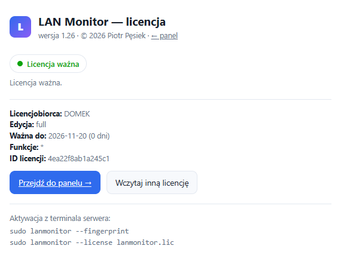

# Jak aktywować licencję LAN Monitor

Po instalacji aplikacja działa **14 dni w pełnej wersji (FULL)**. Aby korzystać dalej,
wgraj licencję. Są dwa sposoby: przez pulpit w przeglądarce (najprościej) albo z konsoli.

## 1. Przez pulpit (zalecane)
1. Otwórz **`http://localhost:8787/license`**.
2. Skopiuj **„Odcisk tego serwera”** (przycisk *Kopiuj odcisk*) i wyślij go wydawcy,
   jeśli kupujesz licencję przypiętą do komputera. (Dla licencji „na dowolny komputer”
   odcisk nie jest potrzebny.)
3. Gdy dostaniesz plik **`lanmonitor.lic`** na e‑mail:
   - kliknij **„Wczytaj plik .lic…”** i wskaż otrzymany plik (albo wklej jego treść w pole),
   - kliknij **„Aktywuj”**.
4. Status zmieni się na **„Licencja ważna”** — gotowe.



## 2. Podmiana aktywnej licencji
Jeśli masz już aktywną licencję i chcesz ją zmienić (np. na nowszą albo testową):
na stronie `/license` kliknij **„Wczytaj inną licencję”**, wklej nową i **„Aktywuj”** —
zastąpi obecną. Nie trzeba ruszać żadnych plików.

## 3. Z konsoli serwera (opcjonalnie)
Jako administrator:
```
sudo lanmonitor --fingerprint          # pokaże odcisk serwera
sudo lanmonitor --license lanmonitor.lic
```
(na Windows uruchom wiersz poleceń jako administrator; polecenie bez `sudo`)

## Najczęstsze pytania

**Skąd wziąć plik `.lic`?**
Dostajesz go e‑mailem po zakupie. Jeśli nie dotarł — sprawdź spam albo napisz do wsparcia.

**„Podpis licencji nieprawidłowy” albo aktywacja się nie udaje.**
Najczęściej licencja została wystawiona dla innego komputera (zły odcisk) lub plik został
uszkodzony przy kopiowaniu. Wgraj plik `.lic` bez zmian (najlepiej „Wczytaj plik .lic…”),
a jeśli nie pomoże — odeślij wydawcy aktualny odcisk serwera ze strony `/license`.

**Czy po reinstalacji trial zacznie się od nowa?**
Nie. Okres próbny jest powiązany z komputerem, więc ponowna instalacja go nie odnawia.

**Czy dane wychodzą do internetu?**
Nie. Monitoring działa lokalnie; dane zostają na Twoim komputerze/serwerze.

---
Potrzebujesz pomocy? Kontakt: **Piotr Pęsiek** — podatnosci@wp.pl
