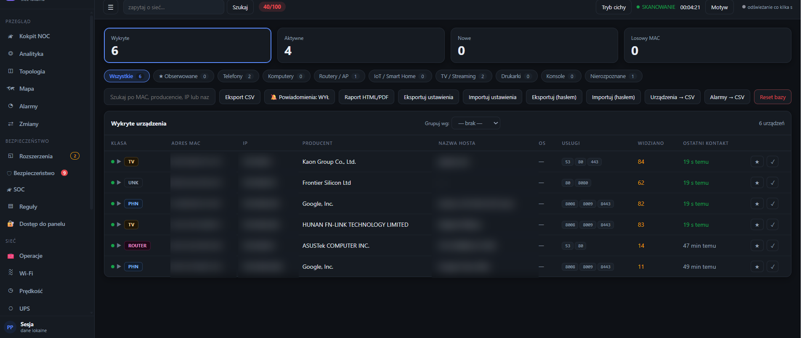

# LAN Monitor

**Monitoring sieci lokalnej (LAN) dla firm i działów IT.** Wykrywa urządzenia, pilnuje
zmian w sieci, alarmuje o nowych/znikających hostach, konfliktach ARP, otwartych portach
i anomaliach, wszystko w przeglądarce, bez chmury. Dane zostają u Ciebie.

> Pobierz, zainstaluj i korzystaj **14 dni za darmo w pełnej wersji (FULL)**. Potem
> aktywujesz licencję, żeby działać dalej.

## Dla kogo
- Małe i średnie firmy, które chcą wiedzieć, co jest w ich sieci.
- Działy IT i administratorzy, szybki przegląd urządzeń, alarmy, historia zmian.
- Dostawcy usług IT / MSP, monitoring sieci wielu klientów (edycja MSP).

## Najważniejsze funkcje
- **Automatyczne wykrywanie urządzeń** w sieci (skan ARP) z nazwą, IP, MAC, producentem.
- **Alarmy** o nowych i znikających urządzeniach, konfliktach ARP, zmianach bramy.
- **Historia** zmian w sieci i podgląd „na żywo”.
- **Pulpit w przeglądarce** pod adresem `http://localhost:8787` nic nie instalujesz u klientów.
- **Działa lokalnie** bez wysyłania danych do chmury.
- **Instalacja jako usługa systemowa** (Windows) startuje z komputerem, działa w tle.

## Pobierz
**Windows** (1.26): **[⬇ LANMonitor-Setup-1.26.exe](../../releases/latest/download/LANMonitor-Setup-1.26.exe)** — Windows 10/11 (64‑bit), uruchom **jako administrator**.

**Linux** (1.26, pakiet .deb): **[⬇ lanmonitor_1.26.0_amd64.deb](../../releases/latest/download/lanmonitor_1.26.0_amd64.deb)** — Debian/Ubuntu (amd64), wersja utwardzona. Szczegóły: **[LINUX.md](LINUX.md)**.

Pełne wymagania sprzętowe i wydajność **[WYMAGANIA.md](WYMAGANIA.md)**.

## Szybki start
1. Uruchom `LANMonitor-Setup-1.26.exe` (jako administrator).
2. Otwórz pulpit: `http://localhost:8787`.
3. Korzystasz z pełnej wersji przez 14 dni. Aby działać dalej, aktywuj licencję:
   patrz **[JAK_AKTYWOWAC.md](JAK_AKTYWOWAC.md)**.

## Edycje i cennik
| Edycja | Dla kogo | Orientacyjnie |
|---|---|---|
| **Standard** | pojedyncza sieć / mała firma | od 790 zł/rok|
| **Pro** | większe sieci, więcej funkcji | od 1990 zł/rok|
| **FULL** | pełny zestaw funkcji | od 5900 zł/rok|
| **MSP** | obsługa wielu klientów | wycena indywidualna |

Co dokładnie zawiera każda edycja **[FUNKCJE.md](FUNKCJE.md)**. Pełny cennik **[CENNIK.md](CENNIK.md)**.
Wymagania sprzętowe i wydajność **[WYMAGANIA.md](WYMAGANIA.md)**.

## Zakup i aktywacja
Po zakupie otrzymasz plik licencji `.lic` na e‑mail. Aktywacja zajmuje chwilę
instrukcja w **[JAK_AKTYWOWAC.md](JAK_AKTYWOWAC.md)**.

## Kontakt / wsparcie
**Piotr Pęsiek** *e‑mail: podatnosci@wp.pl*

---
© 2026 Piotr Pęsiek. Wszelkie prawa zastrzeżone. Oprogramowanie jest własnością Piotra Pęsiek, zasady
użytkowania w pliku [EULA.md](EULA.md).
